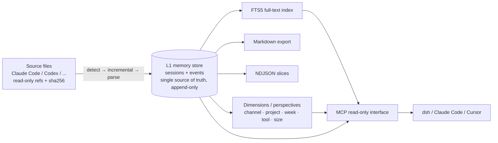

# AgentMemory

[English](README.en.md) · [中文](README.md)

**A local memory store for your AI conversations.** AgentMemory collects sessions from 20+ coding agents — Claude Code, Codex, Cursor, OpenCode, DeepSeek Harness and more — into a single local SQLite database. Markdown exports, full-text search, model-ready slices, statistics and perspectives are all derived from that database. Everything stays on your machine by default, and a read-only MCP interface lets other agents query it.

> Your conversations are scattered across vendor folders. This tool turns them into one **searchable, rebuildable, agent-readable** memory.


## What it solves

| Problem | How AgentMemory handles it |
|---|---|
| Sessions are spread across 20+ tool directories | Detect automatically, collect incrementally, normalize into one event stream |
| Finding a sentence means grepping files | FTS5 full-text search; Chinese matches whole phrases |
| Feeding a model means hand-assembling context | One-click NDJSON export |
| Switching tools loses your history | Read-only MCP interface for dsh / Claude Code / Cursor |
| Tool updates break old formats | The source of truth is append-only; every view can be rebuilt |

## How it works

Two layers. The boundary between them is the whole design:



- **L1 is the only source of truth**: session headers (channel, project, time, title) plus events (messages, tool calls, tool results — with roles, bi-temporal timestamps and parent links). Append-only, never updated (AC-14). Corrections and replays go through "rebuild the derived views" or "re-ingest everything".
- **Everything else is derived**: Markdown, the search index, slices, statistics and perspectives can all be rebuilt from L1 alone (AC-15). Delete them and rebuild — the result is identical.
- **Parser upgrades do not require re-reading source files**: earlier versions rendered Markdown directly, so any rule change meant re-parsing hundreds of megabytes. Now the parser re-reads L1 inside the database.

## Why it is built this way

- **Single writer**: only `store` writes to the database; every other module goes through its methods. All calls within a process share one connection, so the UI can read while collection is writing.
- **Event-level granularity, on purpose**: the store does not split messages into smaller parts. Finer splitting would make the source of truth drift with parser versions; use full-text search when you need to look inside, and leave the store alone.
- **Read-only is what makes it safe to expose**: the five MCP tools can query, but cannot write to the store, touch channel directories, or start a collection. No accounts, no auth.
- **Offline by default**: requests are only made for backups (when git is selected) or capabilities you explicitly enable.

## Features

| Capability | Description |
|---|---|
| Channel detection | Scans your machine on startup and lists available / not-installed channels |
| Incremental collection | Only reads changed source files; first run collects everything, later runs collect only new sessions |
| Memory store | SQLite event stream, idempotent ingestion — collecting twice creates no duplicates |
| Full-text search | Whole-phrase matching for Chinese; filter by channel / project / time |
| Model slices | Export sessions or search results as NDJSON |
| Statistics & perspectives | Channel / project / day / size / tools; weekly activity, weekday×hour, size buckets |
| MCP read-only interface | Search, read session, read dimensions, export slice, stats |
| Backup | Local-only by default; optional git (Markdown + database dump) |
| Scheduled collection | Delegated to Windows Task Scheduler; the app itself does not stay resident |
| Browser extension | Chrome / Edge extension that saves web conversations as Markdown into the same store |

## Quick start

1. Download `AgentMemory-*-exe-plugin.zip` from [Releases](https://github.com/Always1023/AgentMemory/releases) (desktop app + extension + docs).
2. Run `AgentMemory.exe` and follow the three-step setup: choose an archive directory → review detected channels → pick a backup mode.
3. Click "Collect" on the main window. The first run is a full pass; later runs only pick up new sessions.

## Connecting external agents (MCP)

1. Desktop app → Settings → "External interface" → enable. Two values appear: command and argument.
2. Add a `stdio` MCP server in your client:

| Field | Value |
|---|---|
| command | `D:\...\AgentMemory.exe` (full path, **without** `-mcp`) |
| args | `-mcp` |

Claude Code (`~/.claude.json`):

```json
"AgentMemory": {
  "type": "stdio",
  "command": "D:\\path\\to\\AgentMemory.exe",
  "args": ["-mcp"]
}
```

Codex (`~/.codex/config.toml`):

```toml
[mcp_servers.AgentMemory]
command = 'D:\path\to\AgentMemory.exe'
args = ['-mcp']
```

**Common mistake**: putting `-mcp` inside the command field. The client treats the whole string as a filename and fails with `No such file or directory`. In managers such as ccs (CC Switch), command and arguments are separate fields — do not put both in one box. If a tool only has a command field, wrap it in a `.cmd` file containing `"<full path to exe>" -mcp`.

Available tools: `memory_search`, `memory_get_session`, `memory_facets`, `memory_export_ndjson`, `memory_query`, `memory_stats`.

`memory_query` composes the stored granularity: `filter` (channel / project / time / event kind / role / tool / keyword) + `group_by` (channel / project / day / week / kind / tool) + `measures` (sessions / events / chars); 100 rows by default, up to 1000.

The interface is **read-only**: it cannot modify the store, touch source directories, or trigger collection. Disable the switch in Settings and clients can no longer start it.

## Data and privacy

- Config, store and logs: `%APPDATA%\AgentMemory` (override with `AGENTMEMORY_HOME`); the store is `memory.db` there.
- Markdown archive: the directory chosen during setup, defaulting to `%USERPROFILE%\Documents\AgentMemory`.
- The app only reads each tool's own session directory; source data is never modified.
- Offline by default: the only outbound requests are backups (when git is selected).
- Web-archive files are the **only copy** of plugin-captured conversations; migrations and rebuilds never delete or rewrite them.

## Backup

Local-only by default — no network, no third-party accounts. With git selected, the backup covers the Markdown export and a database dump. A failed backup never loses local data; the next run retries.

## Browser capture extension

`extension/` contains the companion Chrome / Edge extension. It batch-saves web AI conversations as Markdown under `<archive>/网页版/<site>/`; the desktop app reports desktop and web sessions separately. See [`extension/README.md`](extension/README.md) for installation and supported sites.

## Development

```bash
# Tests (move GOTMPDIR into the project so antivirus heuristics do not flag fresh test binaries)
export GOTMPDIR="$PWD/.gotmp"
go test ./...

# Frontend syntax check
node --check cmd/agentmemory/frontend/dist/app.js

# Dev server / build
cd cmd/agentmemory && wails dev
cd cmd/agentmemory && GOFLAGS=-trimpath wails build
```

Requirements: Go 1.26, Node 18+ (extension and syntax checks only), Wails v2. Release builds always use `-trimpath`, otherwise local paths leak into the binary.

Code layout (grouped by position in the data flow): `cmd` entry point & UI · `app` orchestration · `store` the store itself (L1 + watermarks + stats + run log + FTS5) · `derive` dimensions & perspectives · `channel` / `channels` adapters · `render` / `archive` exports · `mcp` read-only interface. Module boundaries and constraints live in the architecture document inside the repository (internal documentation, not included in the public repo).

## Feedback

Open an [issue](https://github.com/Always1023/AgentMemory/issues). The tool runs entirely on your machine and never uploads conversations.

---

`README.md` and `README.en.md` are maintained in sync — update both when either changes.
