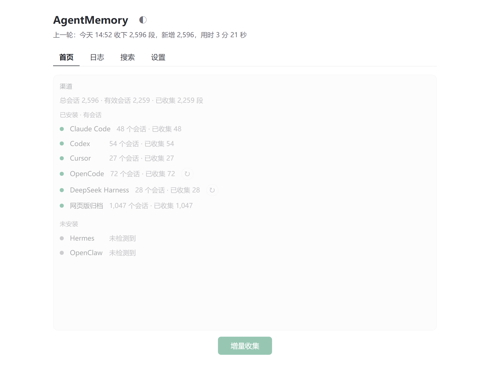
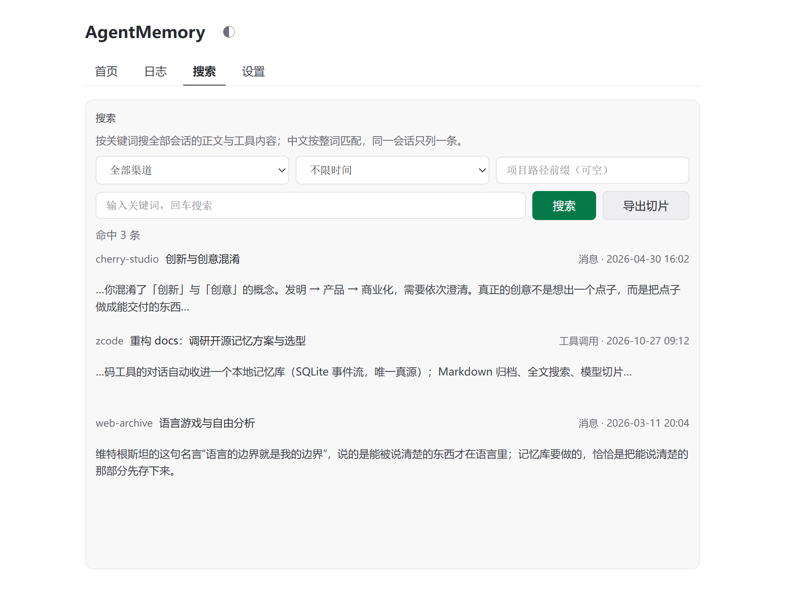
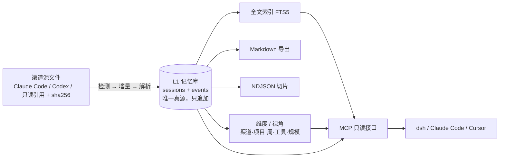

# AgentMemory

[English](README.en.md) · 中文

**本机的 AI 对话记忆库。** 把 Claude Code、Codex、Cursor、OpenCode、DeepSeek Harness 等 20 多个工具的会话，收进一个本地 SQLite 库；Markdown 归档、全文搜索、喂模型的切片、统计与视角，全部从库里派生。默认只留本地，也可以通过只读的 MCP 接口交给其它 Agent 用。

> 你的对话本来就散在各家的文件夹里；把它们收拢成一份**可检索、可重建、可交给 Agent** 的记忆。





## 它解决什么

| 问题 | 这个工具的做法 |
|---|---|
| 会话散落在 20 多个工具各自的目录里 | 自动检测、增量收集，统一成事件流 |
| 想找一句话，只能靠 grep 文件 | FTS5 全文检索，中文按整词匹配 |
| 想喂给模型，还得手工拼上下文 | 一键导出 NDJSON 切片 |
| 换个工具就看不到之前的历史 | MCP 只读接口，dsh / Claude Code / Cursor 都能查 |
| 工具改版、格式变了，历史就废了 | 真源只追加，派生视图随时重建 |

## 工作原理

两层模型，中间那条线是全部设计的关键：



- **L1 是唯一真源**：会话头（渠道、项目、时间、标题）+ 事件（消息、工具调用、工具结果，带角色、双时间戳、父子关系）。只追加，不修改（AC-14）——纠错与重放只有「重建派生」和「全量回灌」两条路。
- **其余全是派生**：Markdown、搜索索引、切片、统计与视角，都能只凭 L1 重建（AC-15）。删掉重来，结果一致。
- **解析规则升级不用回炉源文件**：早期版本把「解析结果」直接写成 Markdown，换一次规则就要把几百 MB 的会话重读一遍；现在重读的是库里的 L1。

## 为什么这样设计

- **单一写入者**：主库只有 `store` 写，其它模块走它的方法。进程内所有调用共用一条连接，收集正在写的时候界面照样能读。
- **事件粒度封顶**：不再往下切「消息内部的段落」。更细的切分会让真源随解析器版本漂移；需要细查时用全文索引，不动真源。
- **只读才敢开放**：MCP 六个工具都能查，但不能写库、不能碰渠道目录、不能触发收集——所以不需要账号与鉴权。
- **默认不联网**：只有备份（选 git）与显式开启的能力才会发请求。

## 能做什么

| 能力 | 说明 |
|---|---|
| 渠道自动检测 | 启动时扫描本机，列出「可用 / 未安装」，不用手填路径 |
| 增量收集 | 只读有变化的源文件；第一次全收，之后只收新的 |
| 记忆库 | SQLite 事件流，幂等入库；重复收集零重复 |
| 全文检索 | 中文整词短语匹配，可按渠道 / 项目 / 时间过滤 |
| 模型切片 | 会话或检索结果导出成 NDJSON |
| 统计与视角 | 渠道 / 项目 / 日 / 规模 / 工具；按周活跃、星期×时段、规模分档 |
| MCP 只读接口 | 检索、读会话、读维度、导出切片、组合查询、概况 |
| 备份 | 默认仅本地；可选 git（Markdown + 主库转储） |
| 定时收集 | 交给 Windows 任务计划程序，程序本身不常驻 |
| 网页版插件 | Chrome / Edge 插件，把网页版对话存成 Markdown 并入库 |

## 快速开始

1. 到 [Releases](https://github.com/Always1023/AgentMemory/releases) 下载 `AgentMemory-*-exe-plugin.zip`（桌面端 + 插件 + 说明）。
2. 双击 `AgentMemory.exe`，跟着三步引导：选归档目录 → 看检测到的渠道 → 定备份方式。
3. 回首页点「增量收集」。第一次全量，之后只收新增。

## 接给外部 Agent（MCP）

1. 桌面端 → 设置页 →「对外接口」→ 打开。下面会显示两项：命令、参数。
2. 在客户端里新增一个 `stdio` 类型的 MCP server：

| 项 | 填什么 |
|---|---|
| 命令 / command | `D:\...\AgentMemory.exe`（exe 完整路径，**不带** `-mcp`） |
| 参数 / args | `-mcp` |

Claude Code（`~/.claude.json`）：

```json
"AgentMemory": {
  "type": "stdio",
  "command": "D:\\path\\to\\AgentMemory.exe",
  "args": ["-mcp"]
}
```

Codex（`~/.codex/config.toml`）：

```toml
[mcp_servers.AgentMemory]
command = 'D:\path\to\AgentMemory.exe'
args = ['-mcp']
```

**常见错误**：把 `-mcp` 一起写进「命令」框。客户端会把整串当文件名，报 `No such file or directory`。用 ccs（CC Switch）这类管理器时，命令与参数是两个框，别填在同一栏；只有单个命令框时，写一个 `AgentMemory-mcp.cmd`（内容 `"<exe 完整路径>" -mcp`）指过去。

接上之后可用：`memory_search`、`memory_get_session`、`memory_facets`、`memory_export_ndjson`、`memory_query`、`memory_stats`。

`memory_query` 用来自由组合已有粒度：`filter`（渠道 / 项目 / 时间 / 事件类型 / 角色 / 工具 / 关键词）+ `group_by`（渠道 / 项目 / 日 / 周 / 类型 / 工具）+ `measures`（会话数 / 事件数 / 字符数），默认 100 行、上限 1000 行。

接口**只读**：不改记忆库、不碰各工具的原始会话文件、不能触发收集。设置里关掉开关，客户端就拉不起来。

## 数据与隐私

- 配置、主库、日志：`%APPDATA%\AgentMemory`（`AGENTMEMORY_HOME` 可换根目录）；主库是其中的 `memory.db`。
- 归档 Markdown：首次引导里选的目录，默认 `%USERPROFILE%\Documents\AgentMemory`。
- 程序只读各工具自己的会话目录，不修改任何原始数据。
- 默认不联网：只有备份（选了 git）才会发出请求。
- 网页版插件的归档是**唯一副本**（没有别的获取途径），程序在任何迁移、重建中都不会删改它。

## 备份

默认「仅本地」——不碰网络、不动别人的账号。选 git 时，备份对象是 Markdown 导出与主库转储；备份失败不丢本地数据，下一轮补做。

## 网页版捕获插件

`extension/` 是配套插件，把网页版 AI 对话批量保存成 Markdown，写到归档目录的 `网页版/<站点>/`，桌面端按「桌面端 / 网页版」分开统计。安装与支持的站点见 [`extension/README.md`](extension/README.md)。

## 开发

```bash
# 跑测试（GOTMPDIR 挪到项目里，避开杀软对新编译测试二进制的误报）
export GOTMPDIR="$PWD/.gotmp"
go test ./...

# 前端语法检查
node --check cmd/agentmemory/frontend/dist/app.js

# 开发模式 / 构建
cd cmd/agentmemory && wails dev
cd cmd/agentmemory && GOFLAGS=-trimpath wails build
```

要求：Go 1.26、Node 18+（仅插件与语法检查用）、Wails v2。分发构建固定带 `-trimpath`，否则本地路径会进 exe。

代码结构（按数据流分四类）：`cmd` 入口与界面 · `app` 编排 · `store` 主库（L1 + 水位 + 统计 + 运行记录 + FTS5）· `derive` 维度与视角 · `channel` / `channels` 渠道适配器 · `render` / `archive` 导出 · `mcp` 只读接口。模块边界与红线以仓库内的架构文档为准（内部文档，公开仓库不含）。

## 反馈

问题与建议走 [Issues](https://github.com/Always1023/AgentMemory/issues)。这个工具只在本机跑，不上传任何对话内容。

---

`README.md` 与 `README.en.md` 保持同步：改一边时两边一起改。
